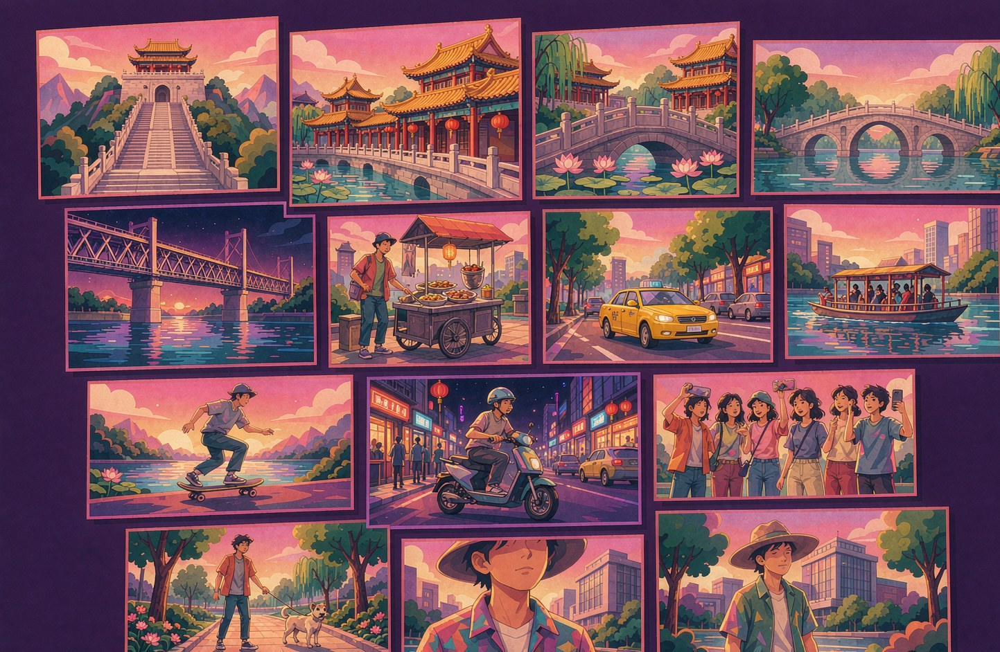
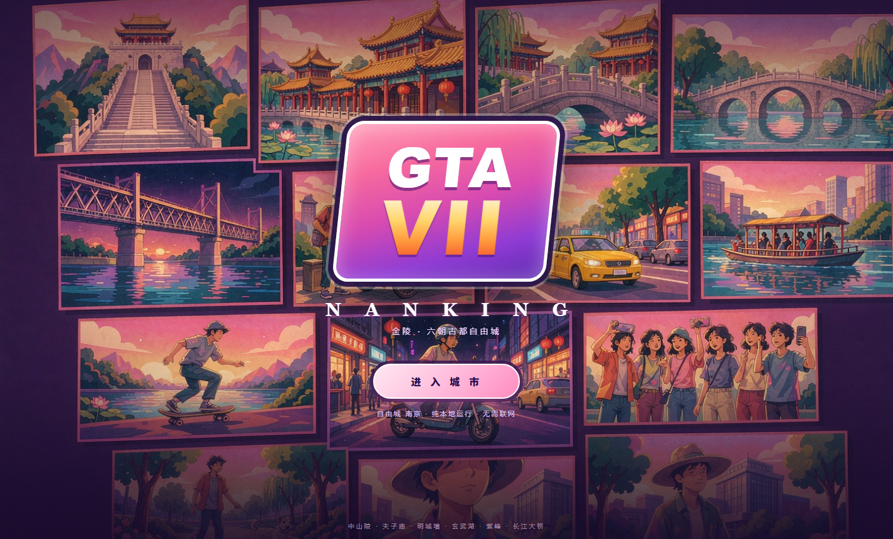
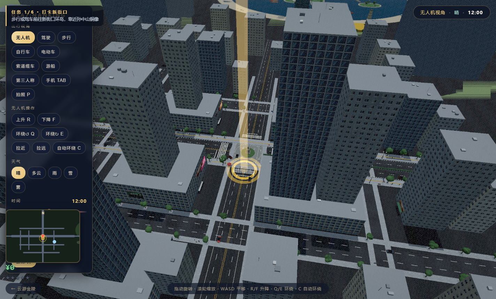
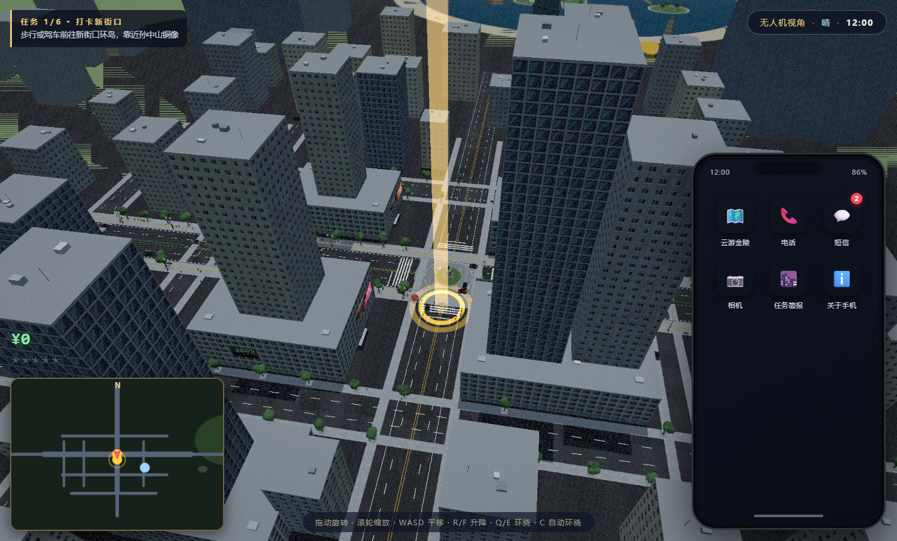
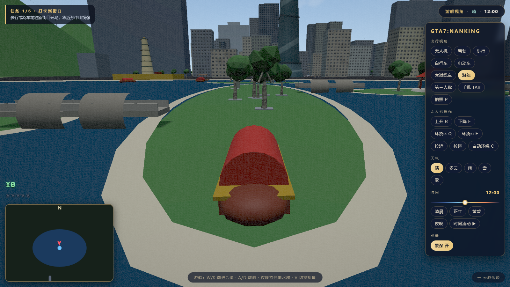
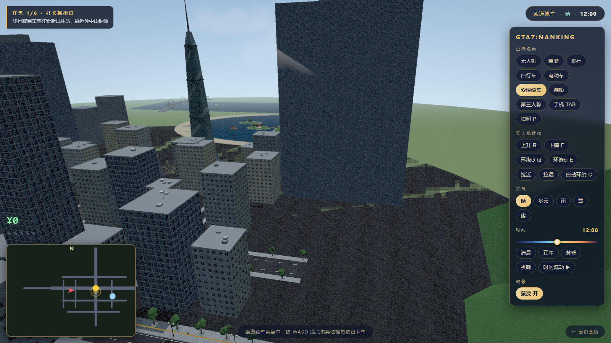

<div align="center">



# GTA7:NANKING —— 南京自由城

**开放世界风格的南京城市模拟游戏（非官方同人作品，纯本地运行）**

`Three.js r159` · `Neutralino.js` · Windows 桌面版 + 网页版 · 无需联网

[](https://github.com/JunHuaBai96/GTA7-Nanking/releases/latest)
[](https://github.com/JunHuaBai96/GTA7-Nanking/releases/latest)

</div>

---

基于 Three.js r159 的 3D 自由城：新街口 CBD、玄武湖、紫金山（中山陵/明孝陵/观景台/索道缆车）、长江大桥、秦淮河、鸡鸣寺。GTA 式任务系统（金色信标 + 现金奖励 + 通缉等级）、小地图、主人公手机（云游金陵 2D 打卡游戏 / 电话 / 短信 / 相机+相册）。

## 🖼️ 游戏画面

> ✅ 已有 4 张 exe 实机截图（含 v1.2.0 新版界面布局）；其余条目 **尚未上传，路径为占位符** —— 截图放入 `docs/screenshots/` 后取消对应 `<!-- TODO -->` 注释即可生效。

<div align="center">

| 截图 | 状态 / 路径 |
|:---:|:---|
| 启动画面 · GTA 封面风格（exe 实机） |  |
| 新街口 CBD · 无人机俯瞰 + 任务信标 · v1.2.0 新布局（exe 实机） |  |
| 主人公手机 · 6 个 App（exe 实机） |  |
| 玄武湖 · 游船视角 | <!-- TODO: 待上传 --> `docs/screenshots/xuanwulake-boat.png` |
| 紫金山 · 索道缆车与中山陵 | <!-- TODO: 待上传 --> `docs/screenshots/zijinshan-cable.png` |
| 长江大桥 · 驾驶视角 | <!-- TODO: 待上传 --> `docs/screenshots/yangtze-bridge-drive.png` |
| 雨天夜景 · 昼夜与天气系统 | <!-- TODO: 待上传 --> `docs/screenshots/weather-night.png` |

</div>

<!-- 截图上传后的推荐展示格式（替换上面的表格）：





-->

## 网页版运行

```bash
cd game
python -m http.server 8412
# 浏览器打开 http://127.0.0.1:8412/3d.html
```

无需联网，全部素材程序化生成（Three.js UMD 已本地化）。

## Windows 桌面版

见 [GitHub Releases](https://github.com/JunHuaBai96/GTA7-Nanking/releases/latest)：下载 `GTA7-Nanking-v1.2.0-win64.zip`，解压后双击 `Start-GTA7-Nanking.cmd`。

技术栈：Neutralino.js（系统 WebView2 承载，exe 仅 2.4MB）。

## 🎮 核心玩法

- **任务系统**：跟随金色信标完成 6 个任务（打卡新街口 → 专车接驾 → 玄武湖泛舟 → 索道登顶 → 鸡鸣寺祈福 → 回城），赚取现金，全通解锁自由模式
- **出行视角（7 种）**：无人机（R/F 升降、Q/E 环绕、C 自动环绕）/ 驾驶 / 步行 / 自行车 / 电动车 / 索道缆车 / 游船，V 键切换第一/第三人称
- **交通**：信号周期红绿灯、NPC 车流跟车避让、行人按灯过街、转弯限速
- **手机（TAB）**：云游金陵 2D 打卡游戏、电话（通话界面）、短信（自动回复）、相机（拍照+相册）、任务简报
- **拍照**：步行模式按 P，照片存入相册
- **天气/昼夜**：晴/多云/雨/雪/雾 × 24 小时关键帧光照，时间可流动

## ✨ 项目亮点

- **纯本地运行**：Three.js 与全部纹理程序化生成，零外部请求
- **小体积桌面版**：Neutralino 打包，exe 仅 2.4MB，无需安装运行时（依赖系统 WebView2）
- **启动封面**：GTA 系列官方封面风格的南京地标拼贴海报（中山陵 / 夫子庙 / 明城墙 / 玄武湖 / 长江大桥 / 紫峰天际线）
- **清晰 HUD 布局**：任务面板左上 · 放大小地图+金钱通缉左下 · 控制面板右上，打开手机自动避让，零遮挡
- **完整开放世界系统**：交通 AI、天气昼夜、多载具、手机生态、存档（localStorage 自动保存）

## 目录结构

```
game/         网页版源码（3d.html 入口，index.html 为手机里的 2D 打卡游戏）
desktop-app/  Neutralino 打包配置
docs/         截图等展示资源（screenshots/ 目录待上传）
```

## 已知限制

- 桌面版需 Microsoft Edge WebView2 Runtime（Win10/11 一般自带）
- 部分低端核显建议保持默认 ANGLE d3d9 渲染（启动脚本已内置）

—— JunHuaBai96 · v1.2.0
